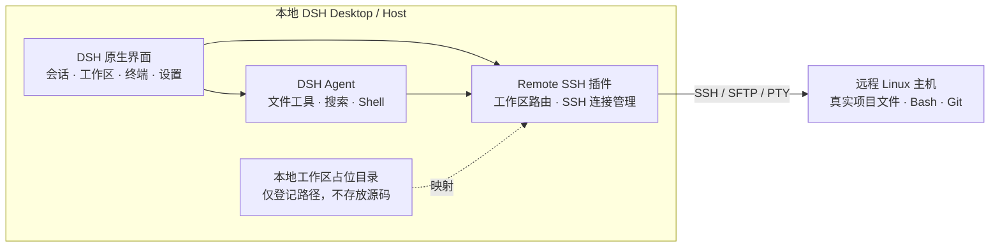

# DSH Remote SSH

[](https://github.com/WeipengMO/dsh-plugin-remote-ssh/actions/workflows/build.yml)
[](LICENSE)

在 [DeepSeek Harness](https://github.com/deepseek-ai/deepseek-harness) 的原生界面中直接打开远程 Linux 工作区。基于轻量 SSH/SFTP，不需要远端 DSH CLI、DSH Core 或额外的 Web 服务，也不会将项目同步到 Windows。

## 功能

- **远程工作区**：在 DSH 新建项目或添加工作区时，选择 SSH 主机与 Linux 目录。
- **远程文件与代码搜索**：Agent 的文件读写、编辑和搜索通过 SSH/SFTP 访问远端目录。
- **原生终端**：DSH 右侧终端连接远程 SSH PTY；远端执行 Bash，本地工作区仍使用自己的终端。
- **Git 状态**：在设置中查看远端仓库状态、未跟踪文件、Diff 统计和提交记录。
- **SSH 主机管理**：支持 `~/.ssh/config`、密钥与 ssh-agent，首次连接需要校验主机指纹。

## 架构



**工作方式**：DSH 的项目注册需要本地路径，插件因此创建稳定的空占位目录，并将属于该工作区的文件、搜索、Shell、Git 只读查询和终端操作路由到远程 Linux。SSH 路由失败时不会静默转成本地执行。

## 安装

从 [GitHub Releases](https://github.com/WeipengMO/dsh-plugin-remote-ssh/releases) 下载最新 `.tgz` 安装包。完全退出 DSH（包括托盘进程），在 Windows PowerShell 中执行：

```powershell
dsh plugin --profile desktop add "C:\\path\\to\\dsh-plugin-remote-ssh-X.Y.Z.tgz"
```

如在 DSH Web Host 上使用，则在 Host 上安装：

```bash
dsh plugin --profile web add /path/to/dsh-plugin-remote-ssh-X.Y.Z.tgz
```

安装或更新后完全重启对应 DSH 进程。

## 使用

1. 在 **设置 → Remote SSH** 添加或从 `~/.ssh/config` 导入主机，测试连接并核对主机指纹。
2. 点击 **新建项目 → 源文件夹 → 远程 SSH**，选择主机及 Linux 目录，创建项目。
3. 进入远程工作区，正常使用 Agent 与右侧终端。可用 `pwd; uname -s; hostname` 核对终端位置。
4. 如需查看生成的文件，使用文件浏览或设置中的 **Git 状态**。右侧 **变更请求** 用于 DSH 会话关联的 Pull Request，不等同于未提交文件列表。

## 开发

环境：Node.js 22、pnpm 10。

```bash
corepack enable
pnpm install --frozen-lockfile --ignore-scripts
pnpm test
pnpm pack
```

更多信息：[架构与安全](docs/architecture.md) · [故障排查](docs/troubleshooting.md) · [第三方组件](docs/THIRD_PARTY.md)

[MIT License](LICENSE)
