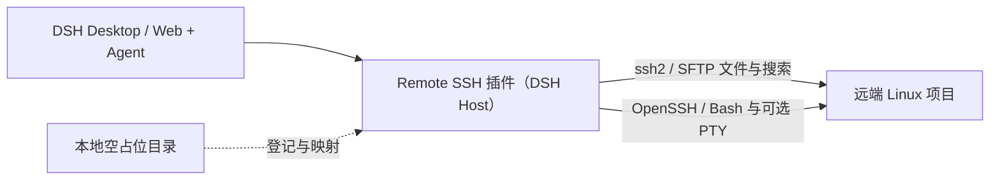

# DSH Remote SSH

[](https://github.com/WeipengMO/dsh-plugin-remote-ssh/actions/workflows/build.yml)
[](https://github.com/WeipengMO/dsh-plugin-remote-ssh/actions/workflows/security.yml)
[](https://www.npmjs.com/package/dsh-plugin-remote-ssh)
[](https://github.com/WeipengMO/dsh-plugin-remote-ssh/releases/latest)
[](LICENSE)

**在 DeepSeek Harness（DSH）中直接打开和操作远程 Linux 项目。** 插件使用 SSH/SFTP 将远程目录接入 DSH 原生项目、Agent 文件工具与可选终端/Git 入口；不需要在远端安装第二套 DSH，也不必把项目源码同步到本机。

*Remote Linux workspaces for DeepSeek Harness via SSH/SFTP, with Agent file operations, approval-gated remote Bash, remote Git status and optional native terminal integration.*

> 社区维护插件，非 DeepSeek 官方内置功能。仓库当前版本为 **1.1.3**；安装时可不指定版本，让 npm Registry 解析当前正式版。完整发布记录见 [CHANGELOG](CHANGELOG.md)。

## 安装（推荐：npm Registry）

插件已以 **[dsh-plugin-remote-ssh](https://www.npmjs.com/package/dsh-plugin-remote-ssh)** 包名发布到 npm。请使用 **DSH 的插件命令**安装，而不是将插件 `npm install -g` 到全局 Node.js 环境。

**Windows/macOS DSH Desktop：** 先启动过一次 Desktop 并完成 profile 初始化，然后**完全退出 Desktop（Windows 还需退出托盘进程）**，在可用的 DSH CLI 中执行：

```powershell
dsh plugin --profile desktop add dsh-plugin-remote-ssh
```

**Linux / DSH Web Host：** 停止正在运行的 DSH Host，再安装到 Web profile：

```bash
dsh plugin --profile web add dsh-plugin-remote-ssh
```

安装完成后**重新启动 DSH Host**，并在 Web 模式下刷新浏览器。Desktop 与 Web 是不同 profile，必须安装到实际使用的那个 profile。可用以下命令检查：

```bash
dsh plugin --profile desktop list
# Web 用户改为 --profile web
```

要求：DSH Host 支持本插件依赖的 `fs`、`shell`、`tools`、`workingDirectory`、`webServer`、`connection` 等插件服务；远端为启用 SSH/SFTP 的 Linux 主机，使用密钥或 ssh-agent 认证；运行 DSH Host 的机器需要 OpenSSH 客户端（`ssh`），远端命令运行需要 Bash。兼容性由实际 DSH 版本和宿主所暴露的可选 API 决定。

### 更新插件

npm 安装的版本可使用 DSH 插件管理界面提供的更新入口（若当前宿主支持），或用 CLI 更新**单个插件**：

```bash
dsh plugin --profile desktop update dsh-plugin-remote-ssh
# Web 用户：
dsh plugin --profile web update dsh-plugin-remote-ssh
```

若需要明确切换到 Registry 最新版本，可用 `add dsh-plugin-remote-ssh@latest`；若要固定版本，可用 `add dsh-plugin-remote-ssh@1.1.3`。更改后均需完全重启相应 DSH Host。更新的是 **DSH 插件**，不是 DSH 主程序。

**之前通过本地 `.tgz` 安装？** 本地文件来源不会自动变成 npm 来源。先备份 DSH profile 和插件配置（通常在 `~/.dsh/remote-ssh/`），完全退出 Host，再用 `dsh plugin --profile desktop add dsh-plugin-remote-ssh@latest`（Web 替换 profile）切换安装来源，重启后检查主机配置和工作区是否保留。不要直接删除远程项目或工作区映射文件。

### 备用安装：GitHub Releases

无法访问 npm 包页面或需要固定构建产物时，可从 [GitHub Releases](https://github.com/WeipengMO/dsh-plugin-remote-ssh/releases/latest) 下载正式 `.tgz`。例如已发布的 [v1.1.3](https://github.com/WeipengMO/dsh-plugin-remote-ssh/releases/tag/v1.1.3)：

```powershell
dsh plugin --profile desktop add "C:\path\to\dsh-plugin-remote-ssh-1.1.3.tgz"
```

```bash
dsh plugin --profile web add /path/to/dsh-plugin-remote-ssh-1.1.3.tgz
```

安装前核对 Release 版本及文件来源；离线下载 tarball 也不保证其依赖在安装时完全不需要访问 npm Registry。源码 `github:` 安装可能受构建脚本安全策略影响，不作为推荐方式。更多说明见 [安装与排障](docs/troubleshooting.md)。

## 能做什么

| 能力 | 当前实现 |
| --- | --- |
| SSH 主机管理 | 在 **设置 → Remote SSH** 添加/编辑主机，支持 `~/.ssh/config` 别名快速导入、密钥或 ssh-agent、首次 Host Key 指纹核验 |
| 原生项目入口 | 在新建项目的源文件夹选择器中选择 **远程 SSH** 主机和 Linux 目录 |
| Agent 文件与搜索 | 将已映射远程工作区的读取、写入、编辑、`glob` / `grep` 请求经 SSH/SFTP 路由到远端 |
| Linux 命令 | 通过 `remote_bash` 运行远端 Bash；默认需要 Agent 会话/远程工作区级审批 |
| 终端与 Git | 宿主提供所需 `subprocess` 能力时适配原生 SSH PTY / Git；设置页提供远端 Git 状态、Diff 统计、近期提交 |
| 本地/远端隔离 | 本地项目仍走 DSH 原生路径，远端项目只在本机登记空占位目录而非同步源码 |
| Web 本地目录选择 | Linux DSH Web 的“本地电脑”指 Web Host 文件系统；原生选框不可用时自动切换网页内目录浏览，可跳转、显示隐藏文件夹和新建目录。Desktop 继续使用原生目录选择框 |

**尚未包含：** Jupyter Notebook Viewer、远端 DSH Host 代理/托管、RDP、离线文件镜像。原生终端与原生 Git 是否可用依赖具体 DSH Host，不能仅凭文件工具正常工作推断它们已经完整接管。

## 快速开始

1. 在 **设置 → Remote SSH** 中新建主机，或使用 `~/.ssh/config` 快速导入。检查地址、用户、端口与密钥路径；首次连接时通过可信渠道核对 **SSH Host Key SHA256 指纹**再确认。
2. 进入 **新建项目 → 源文件夹 → 远程 SSH**，选择主机和远程 Linux 目录，创建项目。插件登记的是本地**空占位目录**，并不会把代码复制到本地。
3. 进入该项目的 Agent 会话，使用 `remote_ssh_status` 检查远程映射，再使用 `remote_bash` 执行 `pwd; uname -s; hostname`。首次命令需要批准；取消/拒绝会阻止执行。
4. 正常使用 DSH 文件工具读写远程项目；检查 Git 状态可打开 **设置 → Remote SSH → Git 状态**。DSH 的“变更请求”面板主要面向 PR，不一定代表远端工作目录的未提交文件。

## 安全边界与已知限制

- **远程 Bash 不是本地 Sandbox。** 被批准的 `remote_bash` 使用远端 SSH 用户权限，可能访问远程工作区以外该用户有权访问的文件；`read-only` 会话禁止执行，审批缺失或拒绝时默认失败。
- `remoteBashApproval` 可设为 `session`（默认，每会话/工作区一次）、`command`（每命令一次）、`off`（不推荐）；`allowLegacyRemoteShell: true` 为不推荐的旧路由兼容开关。旧版 DSH 可能仍显示原生 `bash` / `pwsh` 工具，但默认不能借此绕过远端审批。
- SSH Host Key 未经核实不能自动信任；密钥变化时默认拒绝。插件保存主机/密钥**路径**等配置，不会要求将私钥正文提交到仓库。
- 文件搜索通过 SFTP 完成：`*.py` 只匹配指定目录当前层，`**/*.py` 才递归；递归最多 8 个并发目录读取，预算为 20 秒 / 50,000 条目。超限使用 `SSH_SEARCH_TIMEOUT` 或 `SSH_SEARCH_LIMIT` 标识，请缩小搜索范围。
- 远端执行仅支持前台命令；SSH/SFTP 失败不得静默回退成本地同名目录或本地 Shell。

## 设计与文档



- [架构、安全和工作区映射](docs/architecture.md)
- [安装、迁移与故障排查](docs/troubleshooting.md)
- [维护者：版本发布与 npm Trusted Publishing](docs/releasing.md)
- [CHANGELOG](CHANGELOG.md) · [第三方许可](docs/THIRD_PARTY.md) · [Issues](https://github.com/WeipengMO/dsh-plugin-remote-ssh/issues)

## 本地开发

```bash
corepack enable
pnpm install --frozen-lockfile --ignore-scripts
pnpm test
pnpm pack
```

`pnpm test` 会编译并运行自动化测试；这不等于所有 Desktop/Web、操作系统、真实 SSH 服务器组合都已通过端到端验证。项目遵循 [MIT License](LICENSE)。
