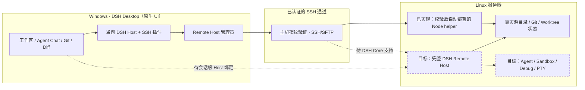

# DSH Remote SSH

[](https://github.com/WeipengMO/dsh-plugin-remote-ssh/actions/workflows/build.yml)

> **目标：Windows DSH Desktop ⇄ Linux DSH Remote Host。** 像 Codex SSH 一样，在**原 Windows Desktop 的工作区列表、聊天、终端、Git 和 Diff 界面**操作远端项目，而不是打开一个新的浏览器 DSH。**目前仍在分阶段实现；v1.5.0 不是完整的 Codex 式远端运行时。**

## 架构（目标与当前实现）



**关键原则**：Windows 负责界面与 Host 选择，Linux 负责实际执行和文件系统。SSH 只负责安全的连接和启动；跨 Host 的 Session、RPC/stream、权限和 Git 路径语义应由 DSH Core 正式接管。当前版本暂时保留 Windows 本地工作区**占位目录**，不能将其当成真实的 Git checkout。

## 功能进度（v1.5.0）

| 能力 | 当前状态 | 备注 |
| --- | --- | --- |
| Windows Desktop 直接选择 SSH 主机和远端工作区 | ✅ 已实现 | 可从 Windows `~/.ssh/config` 自动识别 |
| 已验证的 SSH/SFTP、Linux 文件读写 | ✅ 已实现 | 首次连接必须核对 SSH Host Key |
| Agent Shell / 原生终端 SSH 桥接 | ✅ 已实现（桥接模式） | 不是远端 DSH Agent Session |
| 自动部署 Linux Remote Helper | ✅ **v1.5 新增** | Linux + Node.js ≥20、SFTP、SHA-256 校验 |
| Helper 协议 / 重连时复用 / 生命周期管理 | ✅ **v1.5 新增基础层** | SSH 请求式调用，无常驻开放端口 |
| 从远端真实目录查询 Git 状态、worktree、Diff stat | ✅ **v1.5 新增独立查询** | **不等于**原生 Forge 面板已接入 |
| 识别远端是否安装 DSH | ✅ **v1.5 新增探测** | 不自动安装或升级完整 DSH |
| Linux 完整 DSH Remote Host 自动启动和升级 | ⬜ 未实现 | 需要版本/认证/进程协议 |
| Desktop 原生 Session / Agent 绑定远端 Host | ⬜ 未实现 | 需要 DSH Core 提供每工作区 Host 归属 |
| 原生 Git、Diff、PR、worktree UI 全部使用远端 Host | ⬜ 未实现 | Forge 当前有本地 subprocess/sandbox 假设 |
| 真正远端调试、LSP 和端口转发 UI | ⬜ 未实现 | 需进程生命周期、PTY、Debug Adapter |
| Windows Desktop ↔ Linux DSH 实际 E2E 验收 | ⬜ 未完成 | CI 仅覆盖协议/部署模拟和回归测试 |

**不要将“Helper 已连接”当成“远端 DSH Agent 已连接”。** 该区别会在 Settings → 连接信息中标明。

## Windows Desktop 使用方式

已有的 `ssh nansha` 配置可以复用，不需要每次手动填写 IP、用户或密钥，更不需要手动建 SSH 隧道。

1. 在 Windows DSH Desktop 点击 **新建项目 / 添加工作区 → 源文件夹 → SSH 服务器**。
2. 选择已有 SSH 主机或 Windows `~/.ssh/config` 中的 Host 别名；首次连接时从可信渠道**独立核实 Host Key SHA256 指纹**。
3. 选择服务器上的项目目录并点击 **在 Desktop 打开工作区**。项目出现在原 Desktop 工作区列表中。
4. 插件会**自动尝试**把版本校验过的 Helper 部署到服务器用户目录并做一次远端 Git 查询。若 Node.js 不可用，会给出明确告警，原有 SFTP/Shell 桥接模式仍可使用。
5. **设置 → Remote SSH → 连接信息 → 检查远端 Helper** 可检查 Node、Helper 哈希和远端 DSH CLI 是否存在。这不是每次连接都要操作的前置步骤。

Helper 安装位置：`~/.cache/dsh-remote-ssh/agents/v1/<SHA256>/agent.mjs`。没有后台进程、HTTP 服务或人工维护的 token。SSH 断开后，下次请求会复用版本一致的 Helper 并尝试恢复连接。不会在用户不知情时运行 `npm install` 或下载不固定版本的远端程序。

### Git 的现状

Agent Shell / SSH 终端中的 Git 命令运行在服务器项目目录：

```bash
git rev-parse --show-toplevel
git status --short --branch
git worktree list --porcelain
```

v1.5 Helper 可以独立返回真实的 `root`、`HEAD`、`status`、`worktrees`、`diffStat`。但 **DSH 的右侧「变更请求」面板尚未完成 Remote Host 适配**：若面板依旧提示「无法读取 Git」，不要误以为服务器 Git 失败，也不要通过关闭本地沙箱来绕开问题。

## 远端 DSH Host 的后续实现框架

```text
Windows Desktop                                  Linux Remote Host
───────────────────                              ──────────────────────────
[SSH Host/Workspace picker] -- SSH bootstrap --> [versioned helper] ✔
[Host registry]            -- authenticated  --> [DSH Host process] ⬜
[Connection / RPC]         -- RPC + streams --> [Session/Agent Controller] ⬜
[Native Chat / Tool UI]    <-- Agent events  -- [Agent tools + approvals] ⬜
[Forge Git / Diff UI]      <-- Git RPC       -- [Git + remote sandbox] ⬜
[Terminal / Debug UI]      <-- PTY / DAP     -- [PTY / debug process] ⬜
[Lifecycle & reconnect]   <-- health/events -- [Host lifecycle manager] ⬜
```

必须在 DSH Core/桌面 Shell 补齐的模块：

1. **Per-workspace Host selection**：一个 Desktop 可以同时显示本地项目与多个 SSH Host 的项目，每个 Session/Agent/工作区有稳定的 Host 身份；不能用单一全局 Host 或偷改本地 cwd 实现。
2. **自动启动版本匹配的 Linux DSH**：用严格验证的 SSH 引导完整 DSH Host，协商协议与版本、重连、更新、停止，不依赖用户手动安装、启动 Web 或复制令牌。
3. **Host-Scoped RPC transport**：统一的有身份认证的 RPC、事件流、文件上传下载、审批、取消、后台任务和重试，防止跨 Host 会话或凭据混用。
4. **FS / subprocess / sandbox 原生远程能力**：远端路径规范化、子进程执行、PTY、工作目录、环境、原子文件写入和沙箱策略必须运行在同一个 Linux Host。
5. **Forge / Git / Debug 完整接线**：Git 工作树、Diff、PR 和调试适配器从远端 Host 获取数据，不经过 Windows 本地占位目录。
6. **验收矩阵**：Windows Desktop + Linux 真机验证本地/远端项目切换、Agent、Git、worktree、Diff、PTY、Debug、断网恢复和安全沙箱失败场景。

完整接口、限制与阶段性验收参考：[Remote Helper 协议](docs/remote-runtime-protocol.md)、[Desktop/Core 远端运行时方案](docs/desktop-ssh-runtime.md)、[架构](docs/architecture.md)。

## 安装与更新

从 [GitHub Releases](https://github.com/WeipengMO/dsh-plugin-remote-ssh/releases) 下载与此版本一致的 `dsh-plugin-remote-ssh-1.5.0.tgz`，完全退出 DSH Desktop（包括托盘），然后在 Windows PowerShell 中执行：

```powershell
dsh plugin --profile desktop add "C:\path\to\dsh-plugin-remote-ssh-1.5.0.tgz"
```

重新启动 Desktop。**只有正式发布并在 CI 中验证后才使用此包；不能把 PR 构建当作已发布版本。**

## 开发与测试

```bash
pnpm install --frozen-lockfile --ignore-scripts
pnpm test
pnpm pack
```

CI 检查编译产物、协议测试与打包内容，包括 `runtime/agent.mjs` 和 `dist/remote-host-runtime.js`。Helper 不依赖远端 npm 包，只要求 Linux Node ≥20；完整 DSH Host 的运行要求应以对应 DSH 版本为准。

## 安全和兼容性

- 所有远端操作使用现有的已验证 SSH 身份；从不自动信任未知服务器密钥。
- Helper 文件位于用户私有目录、按内容 SHA-256 命名并在执行前校验；拒绝错误平台、无效协议和篡改文件。
- Helper 没有监听端口、可执行任意 Shell 的 API 或凭据管理功能；Git 查询使用固定只读 argv，限时、限输出；不会自动下载远程软件。
- 拒绝不属于已登记项目的任意浏览器 cwd。SSH/helper 失败会返回状态，不会悄悄在 Windows 占位目录执行 Git。
- v1.4 的独立 Linux DSH Web 功能仍作为**可选、与此目标不同**的工作方式保留，不是原生 Desktop 远程连接方案。

[故障排查](docs/troubleshooting.md) · [源代码](https://github.com/WeipengMO/dsh-plugin-remote-ssh) · [完整运行时的跟踪任务 #12](https://github.com/WeipengMO/dsh-plugin-remote-ssh/issues/12)
