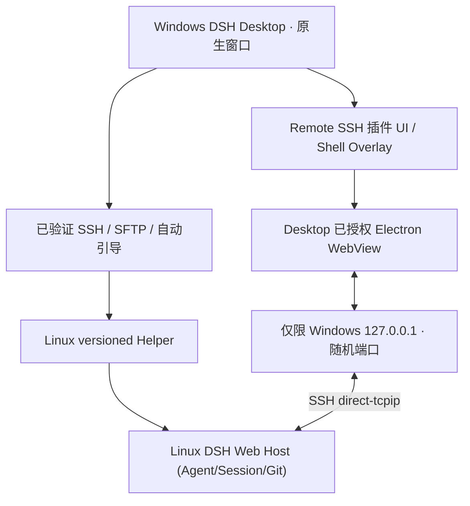

# DSH Remote SSH — Windows Desktop 内嵌完整 Linux DSH

此项目由本仓库独立实现 SSH 连接与自动启动逻辑，不依赖第三方远端 SSH 插件。**v1.6.0 引入真正由远端 Linux DSH 执行 Agent / Git / Session 的 Desktop 内嵌模式。**

## 推荐用法：一键连接完整远端 DSH

1. 在 Windows DSH Desktop 点击 **新建项目 → SSH 服务器**，选择已有的 SSH 配置别名（例如 nansha）和 Linux 工作目录。
2. 点击 **连接完整远端 DSH**。插件使用已验证的 SSH 连接自动启动或复用 Linux 服务器上的 DSH Web，并建立仅绑定本地 127.0.0.1 的加密 SSH TCP 转发。
3. 完整远端 DSH 以 Desktop 主视图的形式加载在同一个窗口中；无需系统浏览器、手动 SSH 隧道、复制 Web token 或修改 DSH Desktop Core。
4. 点击 **返回本地** 关闭视图，远端 DSH 进程与会话继续运行，下次可重新连接。

现有的 **Windows Desktop 文件桥接工作区**仍保留，按钮标记“兼容”。它的 Git/Forge 不保证完整兼容，与推荐的完整远端 DSH 模式不同。

## 架构与身份隔离

- **真正执行位置**：Linux DSH 的工作目录就是在选择器里选中的真实 Linux 路径。新建 Agent 会话、Git、Diff、终端和工作树由那个 Linux DSH 的运行环境负责，不经过 Windows 占位 Git。
- **客户端呈现**：通过官方 Windows Desktop 的浏览器 Guest Lease API（`window.dshDesktop.browser.acquire/release`）创建受控 Electron WebView，并通过官方 `shell.overlay` 扩展槽显示在主工作区域，避免普通 iframe 中 DSH 严格 SameSite Cookie 的兼容问题。
- **远端自动启动**：插件内部已有经 SHA-256 校验的 Node Helper 新增 `web.ensure`，先尝试已有 `dsh`；若无 CLI，用户点击“连接完整远端 DSH”即授权通过 `npx -y @deepseek-ai/dsh@0.2.2-rc.1` 下载固定版本官方 CLI。Linux 必须已有 Node.js ≥24.9；Node.js 和系统依赖不被插件擅自升级。
- **持久性**：每个 Linux 目录一个私有运行记录，`~/.cache/dsh-remote-ssh/web/v1/<SHA256(cwd)>` 保存文件权限限定的 PID、port 和运行日志；访问 token **仅**保留在 mode 0600 日志、经认证的插件 API 应答和 WebView 内存/浏览器历史中，**不写入本地插件配置、Git 或模型对话**。不用人为复制 Web token。
- **隧道**：插件自动建立 TCP 转发，远端 Web 只监听 127.0.0.1。远端访问需要允许 SSH `direct-tcpip`（`AllowTcpForwarding`）；端口未对局域网公开。
- **回退策略**：新模式断线或 WebView 失败显示错误及重试，不得把 Agent 静默切换至 Windows 本地执行。用户可以返回本地 DSH。
- **会话隔离**：Windows 本地 DSH 和 Linux DSH 的会话列表、插件配置、凭据独立；本模式显示一个运行在 Desktop 窗口中的远端 DSH 完整界面，**不是把每条远端 Session 原生合并到本地 Core 的同一个 Session Store**。

## 已知限制

- 这是主窗口内嵌模式，不是 DSH Core `Connection` 的真正会话级 Host 复用；本地会话列表与远端会话列表仍分离。
- 真实 Windows Desktop + Linux SSH 的 Electron/WebView/DSH 交互体验仍需端到端验收。自动化测试只能验证 TypeScript 构建、Helper 令牌识别、启动状态、API 和客户端 UI 注册。
- 如果 Linux 缺少 Node ≥24.9 或 SSH 服务器禁止 TCP 转发，会显示明确错误；不自动改动系统版本和 SSH 服务器策略。
- 固定官方包 `@deepseek-ai/dsh@0.2.2-rc.1` 只在首次必要时下载；远端依赖网络访问 npm registry。可先在服务器按官方说明自行安装 dsh，插件会优先复用。
- 如果远端 DSH 进程重新启动，新的 Web token 会由下一次连接重新读取；不会将过期 token 保存在客户端设置。
- WebView 使用 Chromium 受控沙箱，不能访问 Windows DSH Host 的私有 cookie 或 Node API。部分需系统浏览器、文件下载或原生弹窗的功能仍受 Electron Guest 策略限制。

[技术架构](docs/architecture.md) · [自动启动与安全](docs/remote-runtime-protocol.md) · [排障](docs/troubleshooting.md)
