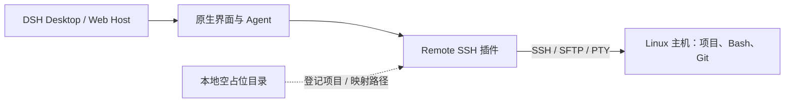

# DSH Remote SSH

[](https://github.com/WeipengMO/dsh-plugin-remote-ssh/actions/workflows/build.yml)
[](https://github.com/WeipengMO/dsh-plugin-remote-ssh/actions/workflows/security.yml)
[](https://github.com/WeipengMO/dsh-plugin-remote-ssh/releases/latest)
[](LICENSE)

在 **DeepSeek Harness (DSH)** 的原生界面中使用远程 Linux 项目：通过 SSH/SFTP 访问文件、运行 Agent 命令和终端，不需要在远端部署 DSH CLI/Core 或独立 Web 服务，也无需将源码同步到本地 Windows。

*Remote Linux workspaces for DeepSeek Harness, with SSH/SFTP file operations, Agent shell routing, and integration with the native DSH UI.*

> **最新正式版本：v1.1.0。** 当前项目为社区插件，不是 DeepSeek Harness 官方内置功能。兼容性取决于 DSH 宿主暴露的插件接口；请在重要项目上使用前自行验证。

## 功能

- **远程项目 / 工作区**：在 DSH 的新建项目与工作区目录选择流程中选择 SSH 主机和远程 Linux 目录。
- **Agent 远程文件操作**：在已激活的远程工作区中，将文件读取、写入、编辑及 `glob`/`grep` 搜索路由到 SSH/SFTP；本地工作区继续使用 DSH 原有实现。
- **Agent 专用 Linux 命令工具**：远程 SSH 会话优先使用 `remote_bash`（模型看到 Bash/POSIX Schema），并在宿主支持 Agent 级工具限制时隐藏 Windows `pwsh`；切回本地时恢复 `pwsh`。旧的 `pwsh` → SSH Shell 执行默认禁止，以防绕过远端审批（可显式开启兼容选项）。
- **原生终端**：在宿主提供 `subprocess.spawnTerminal()` 时，将 DSH 右侧终端的远程工作区会话连接到 SSH PTY；不新增独立终端窗口。
- **Git 状态**：在 Remote SSH 设置页查看远程 `git status`、Diff 统计和近期提交；在兼容的宿主版本中也会尝试适配原生 Git 子进程入口。
- **SSH 主机管理**：支持 `~/.ssh/config`、密钥文件与 ssh-agent、显式主机指纹确认，以及受限的 Cloudflare Access `cloudflared` ProxyCommand。
- **本地/远程隔离**：通过本地空占位目录登记项目，真实代码仍保留在 Linux 主机上。

## 运行要求

- 支持插件安装且提供必需 Host 服务的 DSH Desktop 或 DSH Web Host（包括 `fs`、`shell`、`tools`、`workingDirectory`、`webServer` 和 `connection`）。
- 可通过 SSH 公钥或 ssh-agent 认证访问的 Linux 主机，启用 SFTP 子系统；Agent 远程 Shell 需要远端 Bash。
- 在运行 DSH Host 的机器上提供 OpenSSH 客户端（`ssh`）；可选的原生终端与 Git 集成依赖 DSH `subprocess` 服务。
- 构建与测试：Node.js 22、pnpm 10（插件 `package.json` 声明 Node.js >=20）。

## 安装

**推荐：安装经过 CI 打包检查的正式版压缩包。**

1. 从 [v1.1.0 Release](https://github.com/WeipengMO/dsh-plugin-remote-ssh/releases/tag/v1.1.0) 下载 `dsh-plugin-remote-ssh-1.1.0.tgz`。
2. 完全退出 DSH（Windows 需同时退出托盘进程）。
3. 在运行 DSH 的机器上执行：

```powershell
# Windows DSH Desktop
dsh plugin --profile desktop add "C:\path\to\dsh-plugin-remote-ssh-1.1.0.tgz"
```

```bash
# DSH Web Host
dsh plugin --profile web add /path/to/dsh-plugin-remote-ssh-1.1.0.tgz
```

4. 完全重启对应 DSH 进程；Web 页面如显示旧前端内容，再刷新浏览器。

**从 GitHub 安装（仓库公开后可尝试）：** DSH CLI 支持 Git 来源，示例：

```powershell
dsh plugin --profile desktop add "github:WeipengMO/dsh-plugin-remote-ssh#v1.1.0"
```

Git 安装路径尚未在本项目的干净 Windows Desktop 环境完成端到端验收。若 pnpm 阻止 Git 构建脚本，优先使用上面的正式 `.tgz` 包；不要为了安装插件而全局关闭构建脚本安全限制。**GitHub 公开并不等于插件自动进入 DSH 插件市场。**

无论选择哪种方式，安装器仍可能需要从 npm Registry 下载依赖；网络代理、Registry 连接失败与插件源码公开状态无关。

## 快速开始

1. 进入 **设置 → Remote SSH**，添加 SSH 主机或读取 `~/.ssh/config` 中的主机别名，测试连接。首次连接请通过可信渠道核对并确认完整 SSH Host Key SHA256 指纹。
2. 在 **新建项目 → 源文件夹 → 远程 SSH** 中选择主机和 Linux 路径。插件创建的是本机空占位工作区，真实文件不会复制到这里。
3. 打开远程项目的 DSH 会话；首次使用 `remote_bash` 会请求对当前 Agent 会话/SSH 工作区的 Bash 命令执行授权。可执行 `pwd; uname -s; hostname` 验证平台。
4. 通过设置页中的 **Git 状态** 查看未提交文件、Diff 统计和提交历史。DSH 的 **变更请求** 面板主要面向 Pull Request，不能当作工作区未提交文件列表的唯一依据。

## 版本与更新

正式版以 [GitHub Releases](https://github.com/WeipengMO/dsh-plugin-remote-ssh/releases) 中的版本标签与 `.tgz` 附件为准。`main` 分支的后续代码不会自动改变已经发布的 Release。升级插件时应安装与 Release 版本一致的 `.tgz`，并**完全退出 DSH Desktop（含托盘进程）再启动**。

本版 `remote_bash` 只支持前台执行；旧的 `pwsh` 远程入口默认拒绝，需显式启用不安全兼容选项才能继续使用。更新详情请参阅 [CHANGELOG](CHANGELOG.md)。

## 远程命令执行权限

**本机 DSH Sandbox 不会隔离远端 Linux Bash。** 因此默认使用 DSH Approval 请求一次 Agent 会话与 SSH 工作区级别的授权，未批准或缺少审批服务时拒绝执行。会话处于 `read-only` 时一律禁止远端 Bash。切换到新 Agent 会话需要重新授权。远端 Bash 命令可访问该 SSH 用户有权限的文件，即使指定的工作目录位于工作区内，也不能视为远端文件系统沙箱。

可选插件配置：`remoteBashApproval: 'session'`（默认，每会话/工作区批准一次）、`'command'`（每条命令批准）、`'off'`（不推荐，关闭额外审批）。旧路由只有显式设置 `allowLegacyRemoteShell: true` 才允许从 `pwsh` 进入 SSH（不推荐）。这些选项不会改变 Linux 账号本身的权限或本地与远端隔离关系。

## 工作原理



DSH 在本机登记一个稳定的目录；插件根据该目录对应的工作区映射，将远程操作路由到 Linux。**占位目录不是源码镜像，也不是远程 Linux 文件系统的本地挂载。**

## 安全与限制

- 主机公钥首次使用时必须人工核对；密钥发生变化时默认拒绝连接。
- 插件使用本机私钥或 ssh-agent 进行认证，不将私钥内容写入插件主机配置；配置文件包含主机地址、用户名和密钥路径，应妥善保护。
- 远程 SSH 命令以远端 Linux 账号的权限运行，并不受本机 Sandbox 约束。请避免在高权限服务器或包含敏感数据的目录中未经审查运行 Agent 命令。
- 原生终端和原生 Git 入口依赖宿主是否暴露对应服务；它们不可用不代表 SFTP 文件路由不可用。
- 当前版本针对 Linux SSH 目标；不提供 RDP、远端 DSH Host 代理服务或离线同步。

详见 [架构与安全](docs/architecture.md)、[故障排查](docs/troubleshooting.md)、[第三方许可](docs/THIRD_PARTY.md)。

## 开发

```bash
corepack enable
pnpm install --frozen-lockfile --ignore-scripts
pnpm test
pnpm pack
```

`pnpm test` 包含构建和本地自动化测试；测试通过不等于已覆盖所有 Windows/Electron、DSH 版本及真实 SSH 服务器组合。PR 请附复现步骤与测试结果。

[MIT License](LICENSE)
